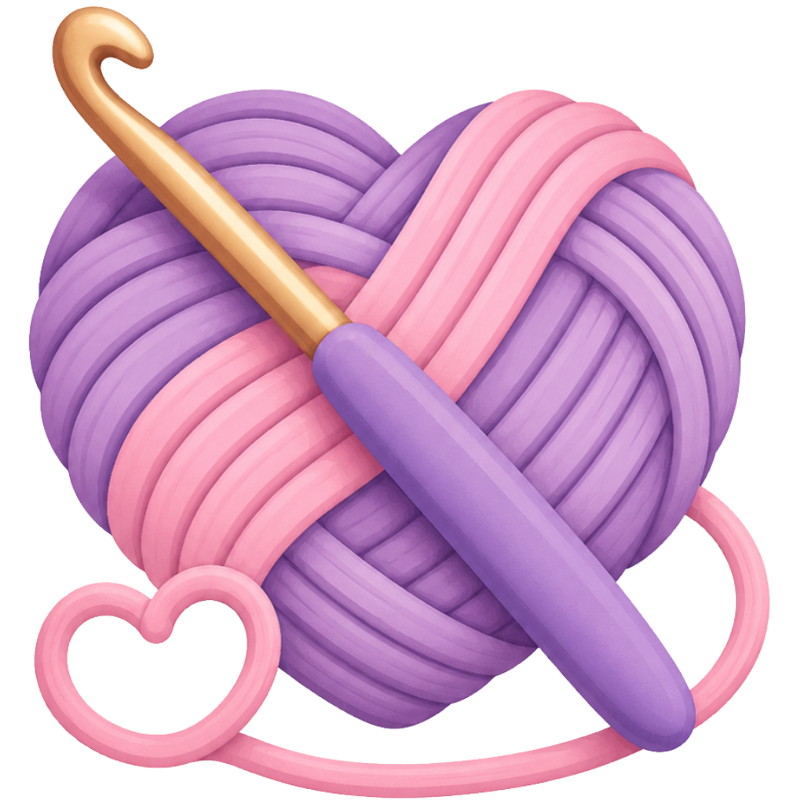

<p align="center">
  
</p>

# Stitchlet

Stitchlet is a self-hosted crochet project tracker. It keeps your pattern PDFs, progress photos, stitch/row counters, and material notes together in one place, on hardware you control — a mini-PC, a NAS, a home server, or just your own machine. No account, no subscription, no third-party server holding your project library.

I made this because my own crochet projects were scattered across printed patterns, PDFs, photos in random folders, and notes on paper. Stitchlet is basically the tool I wanted for keeping all of that in one spot while I'm actually sitting there with yarn in my hands.

<p align="center">
  
  
  
  
</p>

## Features

- Dashboard with search, status filtering (Active, Paused, Finished, Frogged), sorting by updated date/title/status, and grid or list view
- Upload pattern PDFs and read every page in a fit-to-width view, with counters beside the PDF on desktop or in a small dock on phones
- Upload a project photo, with a replace/remove option
- Multiple row or round counters per project, with a picker that controls which counters stay visible while the pattern is open
- Material fields for yarn type, yarn weight, hook size, colors, and finished size, plus custom key/value sections for anything else (safety eyes, stuffing, substitutions, etc.)
- Export a backup ZIP (SQLite database + all uploaded media) from Settings, and restore from one later
- Installable as a PWA, with a service worker that caches the app shell for offline use

## Running with Docker Compose

This is the easiest way to run Stitchlet on a NAS or home server.

Clone the repo and run:

```bash
git clone https://github.com/pinkpixel-dev/stitchlet.git
cd stitchlet
docker compose up -d
```

The included `docker-compose.yml` builds the image from source:

```yaml
services:
  stitchlet:
    build: .
    container_name: stitchlet
    ports:
      - "6497:6497"
    volumes:
      - ./data:/app/data
      - ./uploads:/app/uploads
      - ./backups:/app/backups
    environment:
      - NODE_ENV=production
      - PORT=6497
    restart: unless-stopped
```

Open `http://localhost:6497`.

Two folders get created next to the compose file to hold your data outside the container:

- `data/` — the SQLite database (`stitchlet.db`)
- `uploads/` — pattern PDFs and photos

(`backups/` is mounted too, but nothing writes to it yet — exported backups currently stream straight to your browser as a download instead of landing in that folder. Treat it as reserved for now.)

If you'd rather build and push your own image instead of building on the host, see [DOCKER.md](./DOCKER.md) for the manual `docker build` / `docker push` steps.

## Running locally

**Prerequisites:** Node.js (the Docker image is built on Node 22; that's the version I'd stick to for local dev too — nothing else has been tested).

```bash
npm install
npm run dev
```

This runs Vite and the Hono API concurrently. Vite serves the frontend on `6497` and proxies `/api` requests to the API on `6498`. Open `http://localhost:6497`.

## Configuration

Two environment variables matter:

| Variable | Default | What it does |
| --- | --- | --- |
| `PORT` | `6497` | Port the production server listens on |
| `DATABASE_URL` | `./data/stitchlet.db` | Path to the SQLite database file |

## PWA & remote access

Browsers only allow full PWA install over `localhost` or HTTPS, so how you access Stitchlet affects what you get:

- **On your home network**: hit the host's LAN IP directly, e.g. `http://192.168.1.50:6497`.
- **From outside your network**: Tailscale is the easiest option — run `tailscale serve` on the host and you get HTTPS inside your own tailnet without opening any ports on your router.
- **On a domain**: put a reverse proxy like Caddy in front of it for TLS.

Stitchlet has no login system or user accounts. There's nothing checking who's asking before it serves a project photo, PDF, or the database backup route. "Private" here means you control where it's reachable from, not that it authenticates requests. Keep it on your LAN, or put it behind Tailscale or a reverse proxy that handles auth, rather than exposing the container directly to the internet.

## Backups

- **Export**: Settings → Backup & Restore → Export Backup. This zips the SQLite database and everything in `uploads/` and downloads it straight to your browser.
- **Restore**: pick a previously exported ZIP in Settings. The server closes its database connection, deletes the current database and `uploads/` folder, unpacks the ZIP over them, and then exits the process. It comes back up because of the container's `restart: unless-stopped` policy (or your process manager, if you're running it outside Docker) — there's no restart logic inside the app itself, so make sure whatever you're running it under will actually relaunch it.
- **Host-level backups**: you can also just back up the mounted `./data` and `./uploads` folders directly with whatever backup tool your server already uses.

## License

Apache 2.0

Made with 💖 by [Pink Pixel](https://pinkpixel.dev)
